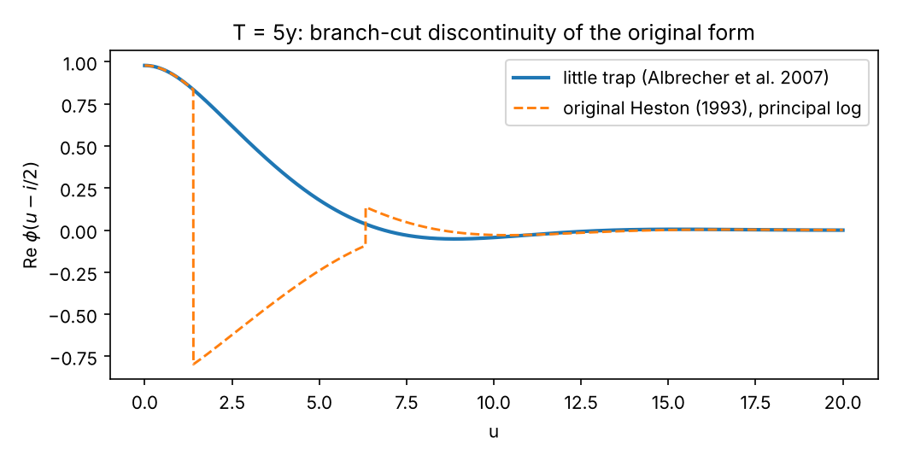
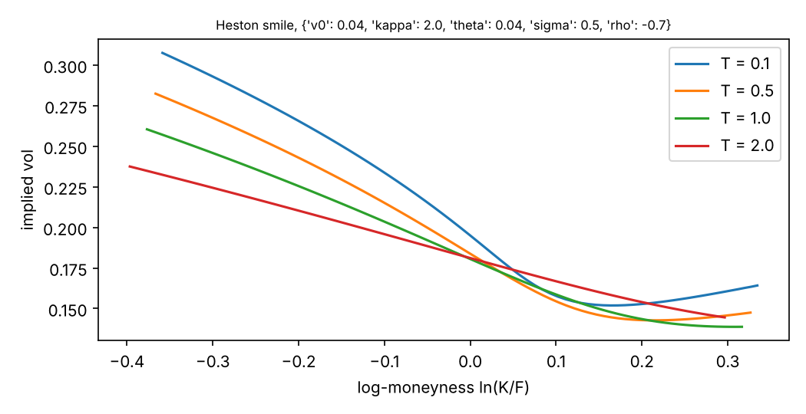

# Phase 1 results: analytic Heston pricer

Generated by `scripts/run_phase1.py` (Python 3.13.18, numpy 2.5.3).

## 1. Literature benchmark (Fang & Oosterlee 2008)

Parameters: {'v0': 0.0175, 'kappa': 1.5768, 'theta': 0.0398, 'sigma': 0.5751, 'rho': -0.5711}, S0 = K = 100, T = 1, r = q = 0. Feller ratio = 0.379 (violated).

| Method | Call price | vs published 5.785155450 |
|---|---|---|
| Lewis + composite GL (primary) | 5.7851554344 | -1.56e-08 |
| Lewis + adaptive quad | 5.7851554344 | -1.56e-08 |
| Gil-Pelaez two-probability (quad) | 5.7851554344 | -1.56e-08 |
| Lewis, mpmath 30 digits | 5.7851554344 | -1.56e-08 |

The 30-digit value is 5.7851554343761890. All three double-precision methods agree with it to 1.1e-12; the published 9-decimal figure is 1.6e-8 higher. The mpmath row uses the same Lewis/little-trap formula; the Gil-Pelaez row is an independent formula and agrees too, so we treat the last published digit as not reproducible.

## 2. Primary pricer vs independent Gil-Pelaez formula (random cases)

400 random cases: v0, theta in [0.005, 0.2], kappa in [0.2, 6], sigma in [0.05, 1.5], rho in [-0.95, 0.5], T log-uniform in [1 week, 5y], ln(K/S) in +-0.6 sqrt(T); r = 3%, q = 1%.

| Statistic | Absolute price difference |
|---|---|
| median | 2.60e-12 |
| 99th pct | 5.36e-11 |
| max | 1.14e-10 |

## 3. Speed (single CPU core, wall clock)

| T | Truncation U | CF nodes | GL: ms / 50 strikes | quad: ms / 50 strikes |
|---|---|---|---|---|
| 0.0192 | 361 | 600 | 1.38 | 131 |
| 0.2500 | 261 | 480 | 1.25 | 177 |
| 1.0000 | 141 | 336 | 1.15 | 126 |
| 5.0000 | 45 | 216 | 1.08 | 107 |

## 4. Black-Scholes limit (sigma -> 0)

With sigma -> 0 the variance is deterministic, E[v_t] = theta + (v0 - theta) e^{-kappa t}, so the Heston price must converge to BS with variance equal to the time-average of E[v_t]. v0 = 0.06, kappa = 1.5, theta = 0.03, T = 0.75, K = 80/100/120.

| rho | sigma | max abs diff vs BS |
|---|---|---|
| 0.0 | 0.1 | 2.44e-02 |
| 0.0 | 0.01 | 2.45e-04 |
| 0.0 | 0.001 | 2.45e-06 |
| -0.7 | 0.1 | 2.94e-01 |
| -0.7 | 0.01 | 2.81e-02 |
| -0.7 | 0.001 | 2.80e-03 |

Observed: error falls ~100x per 10x smaller sigma when rho = 0 (second order) and ~10x when rho != 0 (first-order correlation/vanna term), as the small-vol-of-vol expansion predicts.

## 5. Independent Monte Carlo check (full-truncation Euler)

Parameters {'v0': 0.04, 'kappa': 2.0, 'theta': 0.04, 'sigma': 0.3, 'rho': -0.7} (Feller ratio 1.78), T = 1, r = 3%, q = 1%, 200,000 paths (antithetic), 250 steps. Phase 2 replaces this with Andersen QE.

| Option | Analytic | MC | MC s.e. | z |
|---|---|---|---|---|
| call 80 | 22.7818 | 22.7981 | 0.0137 | +1.19 |
| call 100 | 8.5996 | 8.6096 | 0.0165 | +0.61 |
| call 120 | 1.6041 | 1.6030 | 0.0100 | -0.11 |
| put 90 | 3.2802 | 3.2762 | 0.0154 | -0.26 |

## 6. Why the little-trap characteristic function

Parameters {'v0': 0.04, 'kappa': 2.0, 'theta': 0.04, 'sigma': 0.6, 'rho': -0.8}, S = F = 100 (r = q = 0). Same Lewis integral and nodes, only the CF form changes. With numpy's principal-branch complex log, the original Heston (1993) form jumps branches along the integration path; nodes where it overflows (e^{+dT}) are dropped, which is what a naive implementation would effectively do.

| T | K=80 trap / 1993 | K=100 trap / 1993 | K=120 trap / 1993 |
|---|---|---|---|
| 0.5 | 20.8782 / 20.8782 | 4.9865 / 4.9865 | 0.0577 / 0.0577 |
| 1 | 21.9228 / 22.0066 | 6.8832 / 6.7977 | 0.4196 / 0.3606 |
| 2 | 23.6429 / 23.1519 | 9.7819 / 12.9898 | 2.0509 / 5.3538 |
| 5 | 27.8108 / 42.5404 | 15.8811 / 36.0236 | 7.7309 / 28.6219 |
| 10 | 33.0872 / 67.6412 | 22.7704 / 62.8467 | 15.0532 / 58.1862 |

## 7. Implied-volatility smile produced by the model

Negative rho produces the equity-style downward skew; it flattens with maturity.

