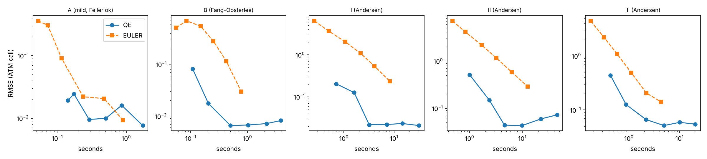
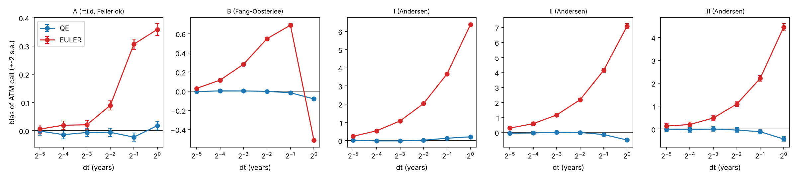

# Phase 2 results: Monte Carlo (Andersen QE vs full-truncation Euler)

Generated by `scripts/run_phase2.py` (Python 3.13.18, numpy 2.5.3); 1,000,000 paths per point (antithetic pairs), S0 = 100, r = q = 0. Total runtime 4.1 min on one core. Truth = Phase 1 analytic price. Bias = MC - analytic; s.e. from antithetic-pair averages; '*' marks |bias| > 2 s.e. (statistically significant at ~5%). Raw numbers: `reports/phase2_bias.csv`.

## 1. Test cases

| Case | v0 | kappa | theta | sigma | rho | T | Feller ratio | Strikes | Analytic calls |
|---|---|---|---|---|---|---|---|---|---|
| A (mild, Feller ok) | 0.04 | 2.0 | 0.04 | 0.3 | -0.7 | 1 | 1.778 | 80 / 100 / 120 | 21.6516 / 7.6157 / 1.2406 |
| B (Fang-Oosterlee) | 0.0175 | 1.5768 | 0.0398 | 0.5751 | -0.5711 | 1 | 0.379 | 80 / 100 / 120 | 21.2366 / 5.7852 / 0.4828 |
| I (Andersen) | 0.04 | 0.5 | 0.04 | 1.0 | -0.9 | 10 | 0.040 | 70 / 100 / 140 | 35.8498 / 13.0847 / 0.2958 |
| II (Andersen) | 0.04 | 0.3 | 0.04 | 0.9 | -0.5 | 15 | 0.030 | 70 / 100 / 140 | 37.1697 / 16.6492 / 5.1382 |
| III (Andersen) | 0.09 | 1.0 | 0.09 | 1.0 | -0.3 | 5 | 0.180 | 70 / 100 / 140 | 38.7720 / 21.7953 / 9.9831 |

## 2. Bias by time step

### Case A (mild, Feller ok)

| dt | QE K=80 | QE K=100 | QE K=120 | EULER K=80 | EULER K=100 | EULER K=120 |
|---|---|---|---|---|---|---|
| 1 | -0.0544 (0.0045)* | +0.0176 (0.0076)* | +0.0699 (0.0042)* | -0.4610 (0.0074)* | +0.3588 (0.0105)* | +0.9100 (0.0067)* |
| 1/2 | -0.0486 (0.0049)* | -0.0232 (0.0074)* | +0.0072 (0.0040) | +0.0270 (0.0090)* | +0.3063 (0.0091)* | +0.3491 (0.0051)* |
| 1/4 | -0.0177 (0.0054)* | -0.0060 (0.0074) | -0.0000 (0.0040) | +0.0095 (0.0081) | +0.0898 (0.0082)* | +0.0972 (0.0043)* |
| 1/8 | -0.0068 (0.0057) | -0.0066 (0.0074) | +0.0004 (0.0040) | -0.0100 (0.0073) | +0.0206 (0.0078)* | +0.0296 (0.0041)* |
| 1/16 | -0.0112 (0.0059) | -0.0143 (0.0074) | -0.0078 (0.0040) | +0.0086 (0.0067) | +0.0191 (0.0076)* | +0.0150 (0.0040)* |
| 1/32 | -0.0023 (0.0061) | -0.0017 (0.0075) | -0.0034 (0.0040) | -0.0022 (0.0064) | +0.0055 (0.0075) | +0.0075 (0.0040) |

### Case B (Fang-Oosterlee)

| dt | QE K=80 | QE K=100 | QE K=120 | EULER K=80 | EULER K=100 | EULER K=120 |
|---|---|---|---|---|---|---|
| 1 | +0.0447 (0.0061)* | -0.0811 (0.0051)* | -0.1359 (0.0021)* | -1.0121 (0.0029)* | -0.5115 (0.0065)* | +0.0753 (0.0027)* |
| 1/2 | +0.0330 (0.0079)* | -0.0166 (0.0059)* | -0.0496 (0.0028)* | -0.1163 (0.0103)* | +0.6894 (0.0087)* | +0.5158 (0.0047)* |
| 1/4 | -0.0046 (0.0087) | -0.0021 (0.0062) | -0.0042 (0.0029) | +0.1152 (0.0105)* | +0.5478 (0.0080)* | +0.3116 (0.0039)* |
| 1/8 | -0.0047 (0.0090) | +0.0022 (0.0064) | +0.0007 (0.0028) | +0.0868 (0.0103)* | +0.2808 (0.0073)* | +0.1335 (0.0033)* |
| 1/16 | -0.0039 (0.0094) | +0.0030 (0.0065) | +0.0038 (0.0029) | +0.0264 (0.0101)* | +0.1151 (0.0070)* | +0.0517 (0.0030)* |
| 1/32 | -0.0050 (0.0095) | -0.0050 (0.0065) | -0.0043 (0.0028) | -0.0085 (0.0100) | +0.0290 (0.0069)* | +0.0163 (0.0029)* |

### Case I (Andersen)

| dt | QE K=70 | QE K=100 | QE K=140 | EULER K=70 | EULER K=100 | EULER K=140 |
|---|---|---|---|---|---|---|
| 1 | +0.0783 (0.0207)* | +0.2041 (0.0111)* | -0.0891 (0.0023)* | +3.9389 (0.0345)* | +6.3788 (0.0281)* | +4.2552 (0.0194)* |
| 1/2 | -0.0296 (0.0213) | +0.1256 (0.0122)* | -0.0216 (0.0026)* | +2.1465 (0.0275)* | +3.6642 (0.0198)* | +1.9297 (0.0101)* |
| 1/4 | -0.0223 (0.0213) | +0.0178 (0.0125) | -0.0041 (0.0025) | +1.1818 (0.0243)* | +2.0323 (0.0159)* | +0.7565 (0.0055)* |
| 1/8 | -0.0192 (0.0215) | -0.0180 (0.0127) | +0.0017 (0.0025) | +0.6505 (0.0229)* | +1.0780 (0.0142)* | +0.2736 (0.0036)* |
| 1/16 | -0.0243 (0.0216) | -0.0195 (0.0128) | -0.0044 (0.0025) | +0.2936 (0.0223)* | +0.5349 (0.0135)* | +0.1013 (0.0029)* |
| 1/32 | +0.0212 (0.0216) | +0.0164 (0.0128) | -0.0007 (0.0025) | +0.1133 (0.0219)* | +0.2348 (0.0131)* | +0.0337 (0.0026)* |

### Case II (Andersen)

| dt | QE K=70 | QE K=100 | QE K=140 | EULER K=70 | EULER K=100 | EULER K=140 |
|---|---|---|---|---|---|---|
| 1 | +0.0844 (0.0480) | -0.5093 (0.0442)* | -0.3109 (0.0397)* | +4.6026 (0.0903)* | +7.0841 (0.0867)* | +6.1133 (0.0823)* |
| 1/2 | +0.0720 (0.0448) | -0.1442 (0.0401)* | -0.0434 (0.0343) | +2.6300 (0.0628)* | +4.1325 (0.0582)* | +3.3163 (0.0525)* |
| 1/4 | +0.0066 (0.0481) | -0.0063 (0.0435) | +0.0293 (0.0379) | +1.3070 (0.0518)* | +2.1810 (0.0467)* | +1.6145 (0.0403)* |
| 1/8 | -0.0027 (0.0477) | +0.0035 (0.0429) | +0.0080 (0.0370) | +0.7152 (0.0650)* | +1.1601 (0.0612)* | +0.7905 (0.0568)* |
| 1/16 | -0.0592 (0.0511) | -0.0370 (0.0466) | -0.0261 (0.0413) | +0.3389 (0.0606)* | +0.5813 (0.0567)* | +0.3802 (0.0521)* |
| 1/32 | -0.0690 (0.0459) | -0.0600 (0.0408) | -0.0577 (0.0345) | +0.1654 (0.0517)* | +0.2846 (0.0471)* | +0.1896 (0.0416)* |

### Case III (Andersen)

| dt | QE K=70 | QE K=100 | QE K=140 | EULER K=70 | EULER K=100 | EULER K=140 |
|---|---|---|---|---|---|---|
| 1 | +0.0719 (0.0541) | -0.4334 (0.0507)* | -0.4736 (0.0451)* | +3.0250 (0.0820)* | +4.4492 (0.0784)* | +4.5973 (0.0729)* |
| 1/2 | +0.0915 (0.0556) | -0.1148 (0.0515)* | -0.1444 (0.0453)* | +1.4362 (0.0650)* | +2.2117 (0.0604)* | +2.2223 (0.0539)* |
| 1/4 | -0.0090 (0.0563) | -0.0416 (0.0518) | -0.0323 (0.0453) | +0.6977 (0.0580)* | +1.0901 (0.0529)* | +1.0499 (0.0457)* |
| 1/8 | +0.0085 (0.0561) | +0.0031 (0.0513) | -0.0025 (0.0446) | +0.3033 (0.0572)* | +0.4828 (0.0521)* | +0.4619 (0.0449)* |
| 1/16 | -0.0123 (0.0561) | -0.0293 (0.0512) | -0.0276 (0.0444) | +0.1177 (0.0567)* | +0.2002 (0.0515)* | +0.1939 (0.0444)* |
| 1/32 | -0.0126 (0.0592) | -0.0020 (0.0545) | +0.0183 (0.0480) | +0.0830 (0.0561) | +0.1312 (0.0509)* | +0.1225 (0.0438)* |

## 3. Summary: coarsest time step without significant bias

For each case and scheme: the coarsest dt at which **no** strike shows a significant bias (|bias| <= 2 s.e. at this path count), and the worst |bias| at dt = 1/8.

| Case | QE: clean from dt | QE: max abs bias @1/8 | Euler: clean from dt | Euler: max abs bias @1/8 |
|---|---|---|---|---|
| A (mild, Feller ok) | 1/8 | 0.0068 | 1/32 | 0.0296 |
| B (Fang-Oosterlee) | 1/4 | 0.0047 | none | 0.2808 |
| I (Andersen) | 1/4 | 0.0192 | none | 1.0780 |
| II (Andersen) | 1/4 | 0.0080 | none | 1.1601 |
| III (Andersen) | 1/4 | 0.0085 | none | 0.4828 |

## 4. Euler convergence order

Least-squares slope of log|bias| on log dt over the points where the Euler bias is significant (ATM). First-order weak convergence would give a slope of about 1.

| Case | significant points | slope |
|---|---|---|
| A (mild, Feller ok) | 5 | 1.24 |
| B (Fang-Oosterlee) | 6 | 0.84 |
| I (Andersen) | 6 | 0.94 |
| II (Andersen) | 6 | 0.93 |
| III (Andersen) | 6 | 1.06 |

## 5. Accuracy per unit of CPU time (ATM)

Each point is one run of the table above: x = wall-clock seconds for all paths, y = RMSE estimate sqrt(bias^2 + s.e.^2). Lower-left is better.

## 6. Bias of the ATM call against dt

## 7. Scheme diagnostics

| Case | QE: share of exponential-branch draws (dt=1/8) | QE: martingale-correction fallbacks (all dt) | Euler: share of steps with v < 0 before truncation (dt=1/8) |
|---|---|---|---|
| A (mild, Feller ok) | 0.0% | 0 | 3.7% |
| B (Fang-Oosterlee) | 49.7% | 0 | 27.3% |
| I (Andersen) | 91.7% | 0 | 73.3% |
| II (Andersen) | 92.2% | 0 | 77.1% |
| III (Andersen) | 70.8% | 0 | 42.6% |

## 8. Variance reduction (dt = 1/8, ATM call)

Same number of payoff evaluations in each row. Variance reduction factor = (plain s.e. / s.e.)^2; time-adjusted factor divides by the relative CPU time.

| Case | Estimator | Price | s.e. | VR factor | time-adjusted VR |
|---|---|---|---|---|---|
| A (mild, Feller ok) | plain | 7.6245 | 0.0150 | 1.00 | 1.00 |
| A (mild, Feller ok) | antithetic | 7.6151 | 0.0105 | 2.02 | 2.57 |
| A (mild, Feller ok) | antithetic + control variate | 7.6124 | 0.0103 | 2.10 | 2.69 |
| I (Andersen) | plain | 13.0913 | 0.0189 | 1.00 | 1.00 |
| I (Andersen) | antithetic | 13.0861 | 0.0180 | 1.10 | 1.19 |
| I (Andersen) | antithetic + control variate | 13.0838 | 0.0120 | 2.48 | 2.81 |
