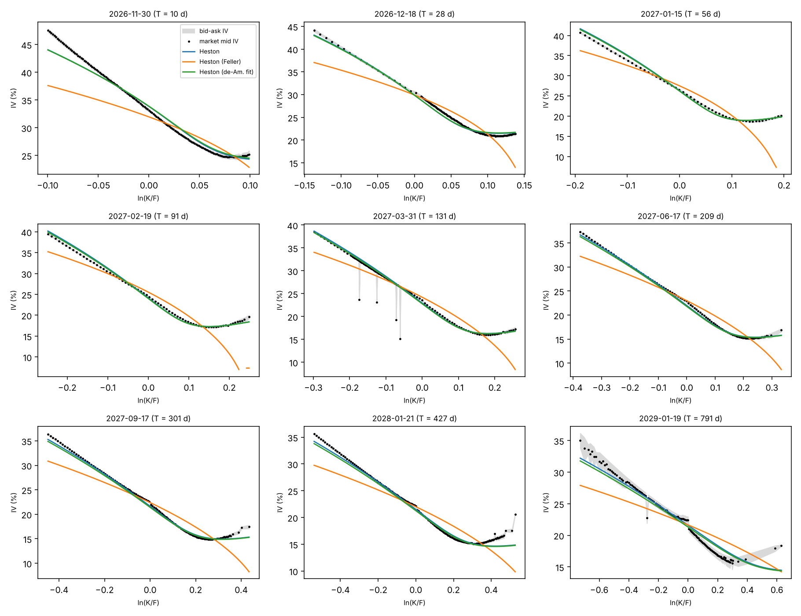
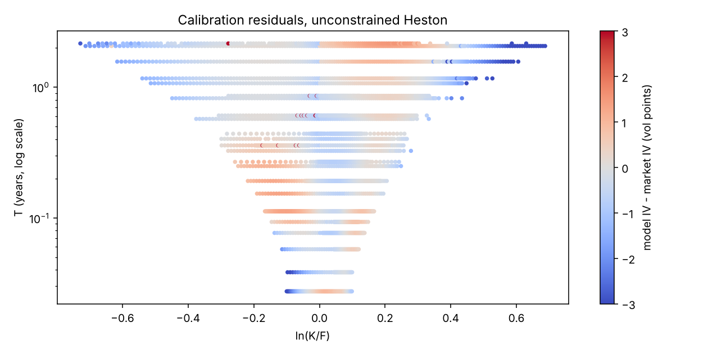

# Phase 3 results: Heston calibrated to the SPY surface (2026-11-20 close)

Generated by `scripts/run_phase3.py` (Python 3.13.18, numpy 2.5.3). Data: `data/spy_2026-11-20/` (Yahoo Finance via yfinance, fetched 2026-11-20T23:28 UTC, sha256-verified on load).

## 1. Market inputs

| Item | Value |
|---|---|
| Last option quote time (UTC) | 2026-11-20 21:14:59+00:00 |
| SPY official close | 689.81 |
| SPY after-hours level implied by the 1-week forward | 693.21 |
| ^IRX (13-week T-bill discount yield) | 4.122% |
| Flat continuous rate r used for discounting | 4.2012% |

The option quotes end about 15 minutes after the equity close and SPY moved after hours, which is why forwards are implied from put-call parity instead of being built from the close.

## 2. Implied forwards (put-call parity, median over near-the-money strikes)

| Expiry | T (y) | F | strikes used | IQR of estimates | implied q |
|---|---|---|---|---|---|
| 2026-11-27 | 0.019 | 693.77 | 12 | 0.06 | -0.00% |
| 2026-11-30 | 0.027 | 693.88 | 54 | 0.09 | 0.64% |
| 2026-12-04 | 0.038 | 694.28 | 11 | 0.06 | 0.17% |
| 2026-12-11 | 0.058 | 694.68 | 11 | 0.06 | 0.52% |
| 2026-12-18 | 0.077 | 693.74 | 25 | 0.52 | 3.20% |
| 2026-12-24 | 0.093 | 694.05 | 11 | 0.18 | 2.90% |
| 2026-12-31 | 0.112 | 694.21 | 55 | 0.19 | 2.91% |
| 2027-01-15 | 0.153 | 695.43 | 11 | 0.24 | 2.11% |
| 2027-01-29 | 0.192 | 696.44 | 47 | 0.44 | 1.77% |
| 2027-02-19 | 0.249 | 698.13 | 11 | 0.53 | 1.36% |
| 2027-02-26 | 0.268 | 698.32 | 29 | 0.31 | 1.47% |
| 2027-03-19 | 0.326 | 699.94 | 11 | 0.47 | 1.24% |
| 2027-03-31 | 0.359 | 700.53 | 23 | 15.40 | 1.27% |
| 2027-04-16 | 0.403 | 701.03 | 8 | 0.33 | 1.41% |
| 2027-04-30 | 0.441 | 702.41 | 27 | 0.46 | 1.21% |
| 2027-06-17 | 0.573 | 705.94 | 11 | 0.98 | 1.02% |
| 2027-06-30 | 0.608 | 706.56 | 47 | 0.85 | 1.06% |
| 2027-09-17 | 0.825 | 712.56 | 11 | 0.87 | 0.86% |
| 2027-09-30 | 0.860 | 712.58 | 20 | 0.66 | 1.00% |
| 2027-12-17 | 1.074 | 718.75 | 11 | 1.23 | 0.83% |
| 2028-01-21 | 1.170 | 720.39 | 11 | 1.07 | 0.91% |
| 2028-06-16 | 1.573 | 731.31 | 11 | 1.47 | 0.80% |
| 2028-12-15 | 2.071 | 744.21 | 11 | 1.65 | 0.77% |
| 2029-01-19 | 2.167 | 745.78 | 11 | 1.77 | 0.83% |

Short expiries carry large positive/negative implied q because the dollar dividend (ex-date mid-December) is spread over a tiny T; only the forward itself enters the pricing, so this is harmless. One expiry (2027-03-31) has a wide IQR from a few bad quotes; the median is unaffected.

## 3. Quote filters

| Step | Quotes left |
|---|---|
| raw quotes | 9421 |
| expiry has an implied forward | 8413 |
| 7 days <= T <= 2.5 y | 8126 |
| out-of-the-money side only | 4706 |
| two-sided quote (bid > 0, ask > bid) | 4404 |
| relative spread <= 50% | 3885 |
| mid >= $0.05 | 3882 |
| |ln(K/F)| <= max(0.5 sqrt(T), 0.1) | 2962 |
| implied vol solvable (inside no-arbitrage bounds) | 2962 |

Final set: 2962 out-of-the-money quotes over 23 expiries, T from 10 days to 2.17 years, market IV 11.2% to 47.5%.

## 4. Early-exercise premium of the quotes used (CRR tree, 300 steps)

| Type | Maturity | Quotes | median (vol pts) | 90th pct | max |
|---|---|---|---|---|---|
| call | 7-30d | 285 | 0.000 | 0.000 | 0.000 |
| call | 1-3m | 371 | 0.000 | 0.000 | 0.000 |
| call | 3-6m | 383 | 0.000 | 0.000 | 0.000 |
| call | 6-12m | 334 | 0.000 | 0.000 | 0.000 |
| call | 1-2.2y | 442 | 0.000 | 0.000 | 0.000 |
| put | 7-30d | 112 | 0.031 | 0.072 | 0.125 |
| put | 1-3m | 202 | 0.041 | 0.148 | 0.218 |
| put | 3-6m | 276 | 0.145 | 0.337 | 0.519 |
| put | 6-12m | 223 | 0.353 | 0.790 | 1.011 |
| put | 1-2.2y | 334 | 0.489 | 1.408 | 2.408 |

Premium measured at each quote's European-inverted IV. Calls carry essentially no premium (low dividend yield). **Puts do, and it grows with maturity**: because r (4.2%) exceeds q (about 1%), the forward is far above spot for long maturities, so a put that is out of the money against the forward can be in the money against spot, and early exercise to earn interest on the strike is valuable. For 1-2 year puts the median premium is comparable to the calibration error below, so ignoring it is **not** negligible there. Section 6 therefore also calibrates to de-Americanised quotes.

### De-Americanisation

For every quote with a positive premium: solve the CRR American volatility sigma_A that reproduces the mid, then subtract the tree's early-exercise premium at sigma_A (American minus European on the same tree, so tree error cancels) and re-invert the European IV. Bid and ask are shifted by the same premium.

1148 quotes adjusted; 0 could not be re-inverted and are dropped from the de-Americanised set. IV reduction: median 0.196, max 2.502 vol points.

## 5. Calibrated parameters (training set, 80% of quotes stratified by expiry)

| Fit | v0 | kappa | theta | sigma | rho | Feller ratio | sqrt(v0) | sqrt(theta) | seconds (10 starts) |
|---|---|---|---|---|---|---|---|---|---|
| Unconstrained, raw quotes | 0.1329 | 8.072 | 0.0556 | 2.246 | -0.774 | 0.178 | 36.4% | 23.6% | 27 |
| Feller-constrained, raw quotes | 0.1107 | 8.488 | 0.0478 | 0.901 | -0.999 | 1.000 | 33.3% | 21.9% | 33 |
| Unconstrained, de-Americanised | 0.1335 | 8.321 | 0.0536 | 2.237 | -0.770 | 0.178 | 36.5% | 23.1% | 26 |

De-Americanising the put quotes moves the unconstrained fit only slightly: theta 0.0556 -> 0.0536, kappa 8.07 -> 8.32, sigma 2.246 -> 2.237, rho -0.774 -> -0.770. The Feller-constrained fit runs into the rho = -0.999 bound: with sigma^2 <= 2 kappa theta it cannot produce enough skew through vol-of-vol, so it pushes correlation to the limit instead.

**Parameters carried into Phases 4-5: the unconstrained raw-quote fit** (as agreed; the de-Americanised fit is a sensitivity).

## 6. Fit quality (IV errors in vol points, i.e. 1.00 = 1% vol)

| Model | Set | Quotes | model IV invertible | IV RMSE | vega-weighted price RMSE | IV MAE | max |IV err| | model price inside bid-ask |
|---|---|---|---|---|---|---|---|---|
| Unconstrained, raw quotes | train | 2370 | 2370 | 0.957 | 0.908 | 0.579 | 11.436 | 24.4% |
| Unconstrained, raw quotes | test | 592 | 592 | 0.849 | 0.726 | 0.552 | 6.945 | 24.3% |
| Feller-constrained, raw quotes | train | 2370 | 2366 | 2.759 | 2.136 | 1.991 | 12.284 | 6.5% |
| Feller-constrained, raw quotes | test | 592 | 591 | 2.506 | 1.981 | 1.893 | 11.376 | 4.9% |
| Unconstrained, de-Americanised | train | 2370 | 2370 | 0.977 | 0.921 | 0.591 | 11.789 | 25.1% |
| Unconstrained, de-Americanised | test | 592 | 592 | 0.877 | 0.749 | 0.565 | 7.749 | 23.8% |
| Black-Scholes, one vol (23.81%) | train | 2370 | 2370 | 6.834 | n/a | 5.522 | 23.720 | n/a |
| Black-Scholes, one vol (23.81%) | test | 592 | 592 | 6.605 | n/a | 5.465 | 21.521 | n/a |

IV statistics use the quotes whose model price can be inverted to an implied vol; a model price outside the no-arbitrage bounds (for example below intrinsic value) cannot, and is counted in the 'invertible' column. The vega-weighted price RMSE (the calibration objective) uses all quotes.

For scale: the median quoted bid-ask spread is 0.31 vol points (mean 0.40).

## 7. Errors by maturity (unconstrained fit, raw quotes, all quotes)

| Maturity | Quotes | IV RMSE | mean err, puts (k<-0.02) | mean err, calls (k>0.02) | inside bid-ask |
|---|---|---|---|---|---|
| 7-30d | 397 | 0.889 | -1.140 | +0.033 | 22.2% |
| 1-3m | 573 | 0.664 | +0.956 | -0.021 | 26.0% |
| 3-6m | 659 | 0.860 | +0.443 | -0.360 | 21.4% |
| 6-12m | 557 | 0.982 | -0.045 | -0.077 | 29.6% |
| 1-2.2y | 776 | 1.139 | -0.405 | -0.113 | 23.2% |

Mean error sign: positive = model IV above market.

## 8. Multi-start behaviour (unconstrained)

| rank | v0 | kappa | theta | sigma | rho | approx IV RMSE | iterations (residual evals, excl. Jacobian) |
|---|---|---|---|---|---|---|---|
| 1 | 0.1329 | 8.0720 | 0.0556 | 2.2457 | -0.7740 | 0.908 | 13 |
| 2 | 0.1329 | 8.0720 | 0.0556 | 2.2457 | -0.7740 | 0.908 | 10 |
| 3 | 0.1329 | 8.0720 | 0.0556 | 2.2457 | -0.7740 | 0.908 | 12 |
| 4 | 0.1329 | 8.0720 | 0.0556 | 2.2457 | -0.7740 | 0.908 | 13 |
| 5 | 0.1329 | 8.0719 | 0.0556 | 2.2457 | -0.7740 | 0.908 | 9 |
| 6 | 0.1329 | 8.0719 | 0.0556 | 2.2457 | -0.7740 | 0.908 | 9 |
| 7 | 0.1329 | 8.0719 | 0.0556 | 2.2457 | -0.7740 | 0.908 | 13 |
| 8 | 0.1329 | 8.0719 | 0.0556 | 2.2457 | -0.7740 | 0.908 | 11 |
| 9 | 0.1329 | 8.0719 | 0.0556 | 2.2457 | -0.7740 | 0.908 | 9 |
| 10 | 0.1329 | 8.0719 | 0.0556 | 2.2457 | -0.7740 | 0.908 | 12 |

10 of 10 starts end within 1% of the best objective value.

## 9. Figures

Market smiles with bid-ask band and the two calibrated models (9 of the expiries):

Residual map (colour = model minus market IV, clipped at +-3 vol points):

## 10. Caveats

* One snapshot on a sharp down day; parameter stability over time is not tested.
* Flat discount rate from ^IRX for all maturities (no Treasury curve available here).
* Early-exercise premium handled by a first-order de-Americanisation with a flat r and a continuous q; the raw-quote fit ignores it (section 4).
* End-of-day quotes from a free source; quote times differ by up to ~15 minutes across strikes.
* A few quotes are clearly bad (e.g. isolated put IVs 10-15 points below their neighbours on 2027-03-31); they pass the filters, are kept, and account for the largest absolute errors. A robust loss (soft-L1) would reduce their influence.
* At the ATM boundary of long maturities the put IVs sit above the call IVs (visible on 2029-01-19); this is the early-exercise premium of section 4 and is what the de-Americanised fit removes.
