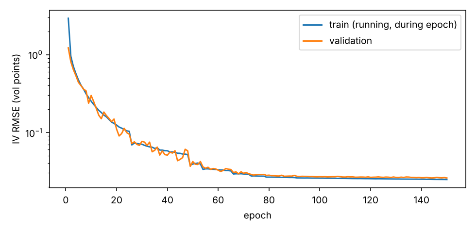

# Phase 4 results: MLP surrogate for the Heston implied-volatility map

Generated by `scripts/run_phase4.py` (Python 3.13.18, numpy 2.5.3, torch 2.15.0+cu132, 4 CPU threads). Labels from the Phase 1 analytic pricer.

Plain-language explanation of the method and a guide to the code: `docs/methodology.md`, section "Neural-network surrogate (Phase 4)".

## 1. Data

| Item | Value |
|---|---|
| (parameter, maturity) slices | 131,072 |
| rows generated (10 strikes per slice) | 1,310,720 |
| rows dropped (OTM price < 1e-9 x forward, IV not invertible) | 2,680 (0.20%) |
| label generation time (4 processes) | 4.1 min |
| train / validation / test rows (split by slice) | 1,046,417 / 130,800 / 130,823 |
| parameter box | v0 [0.005, 0.25], kappa [0.1, 10], theta [0.005, 0.15], sigma [0.1, 3], rho [-0.95, 0] |
| maturity / moneyness | T log-uniform in [7 days, 2.5 y]; ln(K/F) uniform in +-0.6 sqrt(T) |
| label IV range | 1.7% to 61.3% |

## 2. Network and training

| Item | Value |
|---|---|
| architecture | 7 -> 4 x 128 (SiLU) -> 1, 50,689 weights |
| loss / optimiser | MSE on IV; Adam lr 0.001, halved after 3 flat epochs; batch 1024 |
| epochs run / best epoch | 150 / 150 (early stopping patience 10) |
| training time | 7.4 min |
| best validation RMSE | 0.0259 vol points |

## 3. Accuracy on the held-out test slices (vol points; 1.00 = 1% vol)

| Set | rows | RMSE | MAE | 99th pct |err| | max |err| |
|---|---|---|---|---|---|
| test | 130,823 | 0.0258 | 0.0154 | 0.0920 | 0.7013 |

For scale: the median SPY bid-ask spread in Phase 3 was 0.31 vol points.

| Maturity | Moneyness (z = k / (0.6 sqrt T)) | rows | RMSE | MAE | 99th pct | max |
|---|---|---|---|---|---|---|
| 7-30 d | |z| < 0.5 | 19,821 | 0.0215 | 0.0124 | 0.0790 | 0.4545 |
| 7-30 d | |z| >= 0.5 (wings) | 19,636 | 0.0212 | 0.0143 | 0.0758 | 0.2549 |
| 1-3 m | |z| < 0.5 | 15,041 | 0.0228 | 0.0135 | 0.0847 | 0.4325 |
| 1-3 m | |z| >= 0.5 (wings) | 14,933 | 0.0222 | 0.0145 | 0.0759 | 0.3291 |
| 3-12 m | |z| < 0.5 | 18,467 | 0.0263 | 0.0152 | 0.0918 | 0.5119 |
| 3-12 m | |z| >= 0.5 (wings) | 18,343 | 0.0246 | 0.0161 | 0.0886 | 0.2730 |
| 1-2.5 y | |z| < 0.5 | 12,301 | 0.0356 | 0.0199 | 0.1302 | 0.7013 |
| 1-2.5 y | |z| >= 0.5 (wings) | 12,281 | 0.0340 | 0.0206 | 0.1244 | 0.4928 |

Five worst test points:

| v0 | kappa | theta | sigma | rho | k | T | true IV | NN IV |
|---|---|---|---|---|---|---|---|---|
| 0.046 | 0.176 | 0.118 | 0.867 | -0.814 | 0.141 | 1.263 | 0.1052 | 0.0982 |
| 0.046 | 0.176 | 0.118 | 0.867 | -0.814 | 0.128 | 1.263 | 0.1041 | 0.0982 |
| 0.016 | 0.494 | 0.052 | 0.192 | -0.939 | 0.215 | 0.530 | 0.0673 | 0.0724 |
| 0.009 | 9.118 | 0.005 | 0.493 | -0.733 | 0.104 | 0.274 | 0.0577 | 0.0527 |
| 0.009 | 9.118 | 0.005 | 0.493 | -0.733 | 0.113 | 0.274 | 0.0590 | 0.0540 |

Price-space view (forward = 1, so errors are in basis points of the forward): RMSE 0.544 bp, max 22.895 bp.

## 4. Static-arbitrage check on a regular grid

500 parameter vectors from a separate Sobol stream inside the box. Butterfly: call prices must be convex in strike (second difference >= 0) on 41 strikes per maturity. Calendar: total implied variance w = IV^2 T must not decrease with T at fixed ln(K/F) (8 maturities, 9 log-moneyness values in [-0.08, 0.08], inside the domain for every T). Tolerance 1e-10 in price / 1e-8 in total variance.

| Prices from | butterfly violations | calendar violations |
|---|---|---|
| MLP surrogate | 6 / 156,000 | 0 / 31,500 |
| analytic Heston (sanity) | 0 / 156,000 | 0 / 31,500 |

## 5. Speed (wall clock, single process)

| Task | analytic (ms) | MLP (ms, IV only) | speed-up |
|---|---|---|---|
| 50 strikes, one maturity, one parameter set | 0.829 | 0.132 | 6.3x |
| SPY-sized surface: 23 maturities x 130 strikes (2,990 options) | 40.66 | 1.60 | 25.4x |
| 10,000 different (parameter, maturity) points, 1 ATM option each (analytic timed on 1,000, scaled) | 3703 | 4.29 | 863x |

The MLP output is an IV; turning it into a price costs one Black-Scholes call (microseconds per option). The analytic pricer is fastest per option when many strikes share one maturity and one parameter set (one characteristic-function evaluation is reused). The surrogate's advantage is largest when every option has its own parameters or maturity, e.g. scenario revaluation or calibration across many dates.

## 6. Re-doing the Phase 3 SPY calibration with the surrogate

Same quote set as Phase 3 (2962 quotes); 1 fall outside the surrogate's moneyness range (|ln(K/F)| > 0.6 sqrt(T)) and are excluded from both fits below, leaving 2961. All quotes are used (no hold-out) because the point here is to compare the two calibrations.

| Calibrated with | v0 | kappa | theta | sigma | rho | IV RMSE re-priced with the analytic pricer | inside bid-ask | seconds (10 starts) |
|---|---|---|---|---|---|---|---|---|
| analytic pricer (Phase 3 method) | 0.1320 | 7.939 | 0.0555 | 2.217 | -0.775 | 0.936 | 24.5% | 30.9 |
| MLP surrogate | 0.1324 | 8.035 | 0.0565 | 2.301 | -0.764 | 0.923 | 20.8% | 0.7 |

Surrogate approximation error on these 2961 quotes at the analytic optimum: RMSE 0.0107, max 0.0353 vol points.

The IV RMSE column always re-prices the fitted parameters with the exact analytic pricer, so the surrogate is judged by the quality of the parameters it finds, not by its own approximation.

Surrogate multi-start: 10 of 10 starts within 1% of the best objective.
