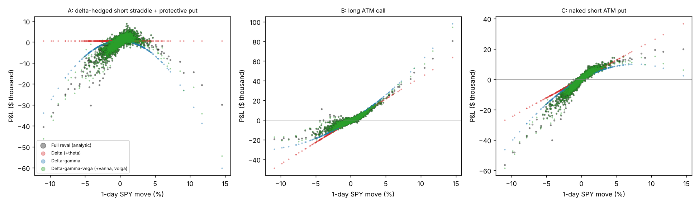
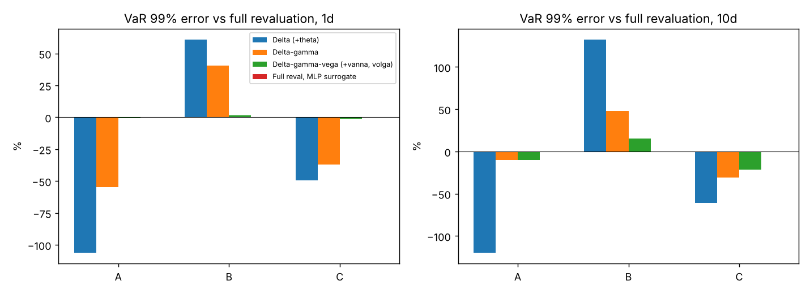

# Phase 5 results: Greeks and non-linear VaR / ES of SPY option books

Generated by `scripts/run_phase5.py` (Python 3.13.18, numpy 2.5.3). Market state = Phase 3 calibration on the 2026-11-20 close; scenarios = daily SPY and VIX closes 2006-01-03 .. 2026-11-20 (5,255 days, Yahoo Finance, sha256-verified).

## 1. Market state and books

| Item | Value |
|---|---|
| Spot S (after-hours level implied by the 1-week forward) | 693.21 |
| Instantaneous variance v0 (sqrt = instantaneous vol) | 0.1329 (36.4%) |
| kappa, theta, sigma, rho (held fixed) | 8.072, 0.0556, 2.246, -0.774 |
| r (from ^IRX) | 4.20% |
| 1M expiry 2026-12-18: T, forward, implied q | 28.0 days, 693.74, 3.20% |
| 3M expiry 2027-02-19: T, forward, implied q | 91.0 days, 698.13, 1.36% |
| ATM strike (listed strike nearest the 1M forward) | 695 |
| 10% OTM put strike (listed strike nearest 0.9 x 3M forward) | 630 |
| Contract multiplier | 100 shares |
| VIX on 2026-11-20 | 35.89 |

| Book | Positions | Value today ($) |
|---|---|---|
| A: delta-hedged short straddle + protective put | short 10 2026-12-18 695C; short 10 2026-12-18 695P; long 10 2027-02-19 630P; +408 SPY shares (delta hedge) | 253,277 |
| B: long ATM call | long 10 2026-12-18 695C | 22,057 |
| C: naked short ATM put | short 10 2026-12-18 695P | -23,311 |

Book A is the original design (sell short-dated volatility, hedge the delta with shares, buy a 3-month crash put). B and C are single unhedged options added for comparison: B is long gamma and long vega, C is short gamma and short vega.

## 2. Greeks (finite differences on the analytic Heston pricer)

Spot bump 0.1% of S, variance bump 1% of v0, one calendar day for theta; kappa, theta, sigma, rho fixed. Units: dollars of book value. Delta in $ per $1 of SPY (= share-equivalents), gamma in $ per $1^2, vega_v per unit of variance, vega per 1 vol point of sqrt(v0), theta per calendar day.

| Book | Delta | Gamma | Vega_v | Vega / vol pt | Vanna | Volga | Theta / day |
|---|---|---|---|---|---|---|---|
| A | 0.0 | -12.00 | -113,646 | -828 | 142.6 | 514,803 | 463 |
| B | 637.8 | 6.74 | 89,917 | 655 | -236.5 | -294,667 | -284 |
| C | 359.8 | -6.74 | -89,917 | -655 | 236.5 | 294,667 | 264 |

For reference, one 2026-12-18 695 call: Heston price 22.06, implied vol 29.7%, Heston delta (v held fixed) 0.638 versus Black-Scholes delta at the same implied vol 0.506. The gap is the skew: with v fixed, a higher spot moves this strike toward the low-strike (high implied vol) side of the smile in moneyness terms, so the option gains extra value. This is the 'sticky moneyness' delta of a stochastic-vol model, not an error.

## 3. VaR and ES by revaluation method

Scenario for day t (horizon h trading days): SPY log return x = ln(S_{t+h}/S_t) and VIX ratio R = VIX_{t+h}/VIX_t, applied to today's state as S' = S e^x, v' = v0 R^2, with time to expiry reduced by h/252 years. 10-day scenarios are overlapping windows (not sqrt(10) scaled), so neighbouring scenarios share 9 days. VaR 99% and ES 97.5% are on loss = -P&L in dollars. Error = method minus full analytic revaluation, in % of the full-revaluation number.

### 1-day horizon (5,254 scenarios)

**Book A: delta-hedged short straddle + protective put**

| Method | VaR 99% ($) | VaR error | ES 97.5% ($) | ES error |
|---|---|---|---|---|
| Delta (+theta) | -670 | -106.2% | -670 | -105.6% |
| Delta-gamma | 4,916 | -54.6% | 6,755 | -43.8% |
| Delta-gamma-vega (+vanna, volga) | 10,772 | -0.5% | 12,246 | +1.9% |
| Full reval, analytic Heston | 10,829 | - | 12,020 | - |
| Full reval, MLP surrogate | 10,806 | -0.2% | 11,999 | -0.2% |

**Book B: long ATM call**

| Method | VaR 99% ($) | VaR error | ES 97.5% ($) | ES error |
|---|---|---|---|---|
| Delta (+theta) | 16,174 | +60.8% | 17,274 | +65.5% |
| Delta-gamma | 14,114 | +40.4% | 14,524 | +39.2% |
| Delta-gamma-vega (+vanna, volga) | 10,193 | +1.4% | 10,569 | +1.3% |
| Full reval, analytic Heston | 10,056 | - | 10,436 | - |
| Full reval, MLP surrogate | 10,050 | -0.1% | 10,433 | -0.0% |

**Book C: naked short ATM put**

| Method | VaR 99% ($) | VaR error | ES 97.5% ($) | ES error |
|---|---|---|---|---|
| Delta (+theta) | 8,509 | -49.3% | 9,129 | -49.4% |
| Delta-gamma | 10,569 | -37.1% | 11,880 | -34.2% |
| Delta-gamma-vega (+vanna, volga) | 16,621 | -1.0% | 17,804 | -1.4% |
| Full reval, analytic Heston | 16,796 | - | 18,051 | - |
| Full reval, MLP surrogate | 16,793 | -0.0% | 18,051 | -0.0% |

### 10-day horizon (5,245 scenarios)

**Book A: delta-hedged short straddle + protective put**

| Method | VaR 99% ($) | VaR error | ES 97.5% ($) | ES error |
|---|---|---|---|---|
| Delta (+theta) | -6,701 | -119.9% | -6,701 | -118.0% |
| Delta-gamma | 30,311 | -10.1% | 37,878 | +1.5% |
| Delta-gamma-vega (+vanna, volga) | 30,362 | -9.9% | 41,481 | +11.1% |
| Full reval, analytic Heston | 33,710 | - | 37,321 | - |
| Full reval, MLP surrogate | 33,686 | -0.1% | 37,293 | -0.1% |

**Book B: long ATM call**

| Method | VaR 99% ($) | VaR error | ES 97.5% ($) | ES error |
|---|---|---|---|---|
| Delta (+theta) | 49,056 | +132.3% | 51,300 | +148.8% |
| Delta-gamma | 31,313 | +48.3% | 30,422 | +47.5% |
| Delta-gamma-vega (+vanna, volga) | 24,383 | +15.5% | 27,988 | +35.7% |
| Full reval, analytic Heston | 21,117 | - | 20,619 | - |
| Full reval, MLP surrogate | 21,122 | +0.0% | 20,625 | +0.0% |

**Book C: naked short ATM put**

| Method | VaR 99% ($) | VaR error | ES 97.5% ($) | ES error |
|---|---|---|---|---|
| Delta (+theta) | 21,524 | -61.0% | 22,790 | -59.9% |
| Delta-gamma | 38,275 | -30.7% | 44,094 | -22.5% |
| Delta-gamma-vega (+vanna, volga) | 43,582 | -21.1% | 53,680 | -5.7% |
| Full reval, analytic Heston | 55,243 | - | 56,903 | - |
| Full reval, MLP surrogate | 55,235 | -0.0% | 56,895 | -0.0% |

## 4. Where the approximations fail

Errors of each method against full analytic revaluation, scenario by scenario (1-day). 'Small moves' = |SPY return| < 1% (74% of days); 'tail' = the 1% of days with the largest full-revaluation loss.

| Book | Method | RMS error, small moves ($) | RMS error, tail ($) | Mean error, tail ($) |
|---|---|---|---|---|
| A | Delta (+theta) | 1,456 | 19,374 | 18,105 |
| A | Delta-gamma | 1,460 | 11,798 | 7,907 |
| A | Delta-gamma-vega (+vanna, volga) | 25 | 6,063 | -184 |
| A | Full reval, MLP surrogate | 4 | 26 | 26 |
| B | Delta (+theta) | 1,163 | 10,272 | -8,115 |
| B | Delta-gamma | 1,165 | 4,696 | -3,813 |
| B | Delta-gamma-vega (+vanna, volga) | 12 | 782 | -299 |
| B | Full reval, MLP surrogate | 2 | 4 | 1 |
| C | Delta (+theta) | 1,163 | 14,127 | 12,937 |
| C | Delta-gamma | 1,165 | 9,564 | 8,376 |
| C | Delta-gamma-vega (+vanna, volga) | 12 | 2,241 | 524 |
| C | Full reval, MLP surrogate | 2 | 6 | 3 |

A positive mean tail error means the method shows a smaller loss than full revaluation (it understates risk); negative means it overstates the loss.

Spot-only versus spot-and-vol scenarios (full analytic revaluation, 1-day): the same historical SPY returns with v0 held at today's level isolate how much of the risk comes from the volatility leg.

| Book | VaR 99%, spot + vol | VaR 99%, spot only | ES 97.5%, spot + vol | ES 97.5%, spot only |
|---|---|---|---|---|
| A | 10,829 | 5,907 | 12,020 | 7,282 |
| B | 10,056 | 13,536 | 10,436 | 13,585 |
| C | 16,796 | 11,150 | 18,051 | 12,822 |

Worst five 1-day scenarios for each book (full analytic revaluation):

| Book | Start date | SPY move | VIX move | Full P&L | Delta | Delta-gamma | D-G-V |
|---|---|---|---|---|---|---|---|
| A | 2020-03-13 | -10.94% | +43.0% | -40,515 | 670 | -33,844 | -46,159 |
| A | 2008-10-14 | -9.84% | +25.6% | -35,579 | 670 | -27,267 | -35,221 |
| A | 2020-03-11 | -9.57% | +40.0% | -33,551 | 670 | -25,717 | -37,234 |
| A | 2018-02-02 | -4.18% | +115.6% | -30,222 | 670 | -4,372 | -988 |
| A | 2008-11-28 | -8.86% | +23.9% | -30,067 | 670 | -21,946 | -29,356 |
| B | 2008-10-14 | -9.84% | +25.6% | -20,042 | -43,936 | -28,229 | -20,955 |
| B | 2008-11-19 | -7.42% | +8.9% | -19,411 | -33,230 | -24,300 | -21,872 |
| B | 2020-03-13 | -10.94% | +43.0% | -19,339 | -48,789 | -29,384 | -17,253 |
| B | 2008-11-28 | -8.86% | +23.9% | -19,295 | -39,573 | -26,857 | -20,168 |
| B | 2008-10-08 | -6.98% | +11.1% | -18,595 | -31,288 | -23,383 | -20,368 |
| C | 2020-03-13 | -10.94% | +43.0% | -56,366 | -26,907 | -46,311 | -58,442 |
| C | 2008-10-14 | -9.84% | +25.6% | -48,072 | -24,169 | -39,876 | -47,150 |
| C | 2020-03-11 | -9.57% | +40.0% | -48,021 | -23,478 | -38,314 | -49,391 |
| C | 2008-11-28 | -8.86% | +23.9% | -41,993 | -21,708 | -34,423 | -41,113 |
| C | 2018-02-02 | -4.18% | +115.6% | -40,070 | -10,047 | -12,882 | -25,175 |

## 5. Surrogate domain and run time

The MLP was trained on v0 <= 0.25, maturities >= 7 days and |ln(K/F)| <= 0.6 sqrt(T). Option evaluations outside that box are priced with the analytic formula instead (counted below), so the NN column is a hybrid in extreme scenarios.

| Book, horizon | Fallback evaluations | Total option evaluations |
|---|---|---|
| A, 1d | 78 | 15,762 |
| B, 1d | 26 | 5,254 |
| C, 1d | 26 | 5,254 |
| A, 10d | 922 | 15,735 |
| B, 10d | 315 | 5,245 |
| C, 10d | 315 | 5,245 |

Wall-clock time per method for all scenarios (milliseconds, single process). Taylor methods need the Greeks first (10 book valuations, a few milliseconds, not included).

| Book, horizon | Delta (+theta) | Delta-gamma | Delta-gamma-vega (+vanna, volga) | Full reval, analytic Heston | Full reval, MLP surrogate |
|---|---|---|---|---|---|
| A, 1d | 0.0 | 0.1 | 0.1 | 8,019.9 | 59.7 |
| B, 1d | 0.0 | 0.0 | 0.0 | 2,470.2 | 21.4 |
| C, 1d | 0.0 | 0.0 | 0.1 | 2,703.5 | 18.6 |
| A, 10d | 0.0 | 0.0 | 0.0 | 8,603.1 | 412.5 |
| B, 10d | 0.0 | 0.0 | 0.1 | 2,969.6 | 159.3 |
| C, 10d | 0.0 | 0.0 | 0.0 | 2,866.7 | 201.2 |

## 6. Assumptions and limits

- Scenarios are real-world (historical) moves; prices are risk-neutral Heston values. This is standard historical-simulation practice, but the model's kappa, theta, sigma, rho are held at their 2026-11-20 calibration ('sticky parameters'): in reality the whole surface would be re-fitted after a shock.
- VIX is a 30-day implied vol, not sqrt(v0); mapping v' = v0 (VIX'/VIX)^2 assumes the instantaneous variance moves in proportion to VIX squared.
- Relative VIX moves are applied to a high starting level (VIX 35.9 today). Historical calm-period changes may understate how violently vol moves from a stressed level, and vice versa.
- SPY prices are unadjusted closes, so the roughly quarterly ex-dividend drops (about 0.3-0.5%) appear as small negative returns. Their effect on 99% VaR is small but not zero.
- There is no backtest: we do not have historical option prices for these exact books, so the VaR is validated only against full revaluation inside the model, not against realised option P&L.
- American early exercise is ignored (European pricing). Phase 3's CRR estimate of the early-exercise premium is 2026-12-18 695C: 0.00 vol pts, 2027-02-19 630P: 0.11 vol pts for the options used here.
